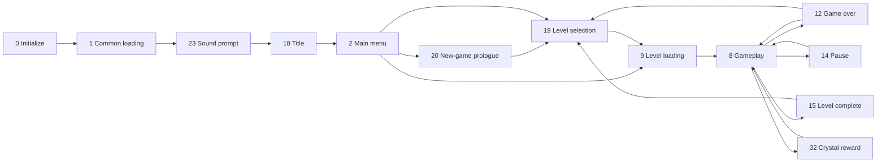

# Game lifecycle and screen state machine

Verified from original `GloftSOFD.java` and `e.java`, especially `paint`
(419), `a(int)` (730), `run` (865), menu dispatch `H(int)` (2481),
`aq()` (4303), and the handlers listed below. Original line numbers refer to
`soul/decompiled`, which is kept unchanged. Renamed identifiers are in
`soul/src/Game.java`; `python tools/outline.py Game` locates their current lines.

## Lifecycle and frame order

`GloftSOFD.startApp` creates one Game canvas and one thread on first entry.
Subsequent calls display the same canvas and resume its loop. `pauseApp` marks
the loop suspended. `destroyApp` writes the existing save buffer only if a
record was successfully loaded, then notifies the platform of destruction.

Game construction clears suspension, initializes Random with the wall clock,
and sets `state=0`, `previousState=-1`, `stateFrame=0`.
The main thread runs until state 11:

1. Record wall-clock frame start.
2. If not suspended, handle eligible delayed sound resume, clear
   `paintComplete`, request repaint and wait in 10 ms sleeps for painting.
3. Measure elapsed time, including the repaint wait. The start timestamp is
   clamped against a backward-moving wall clock.
4. Sleep `max(1, 83-elapsed)` ms. Both branches of a script-status ternary
   use 83; this is not a variable simulation timestep.

`paint` sets the Graphics/DirectGraphics contexts, increments `stateFrame`,
sets `tickDeltaMs=83`, executes the state handler, clears the Graphics reference
and calls `latchInput`. Exceptions are printed; `paintComplete` is set even
after a caught exception. If an exception occurs before latching, that latch
is skipped for that paint. See INPUT.md for the resulting input latency.

This code does not separate rendering from simulation. `updateGameplay`
advances scripts/actors and calls `drawWorld`; `drawWorld` itself mutates HUD,
weather, fades, timed overlays, letterbox bars and even level transitions.
Rendering cannot simply be called at a higher FPS without moving those
mutations to simulation ticks first.

`hideNotify` remembers a playing music ID, stops audio and suspends the loop.
`showNotify` resumes, may reset the screen frame counter, and changes ordinary
gameplay to the pause menu when no scripted interaction blocks it. Eligible
sound resume is delayed by three loop iterations. Explicit pause and loss of
visibility share flags but are not identical callbacks.

## States

The table names observed behavior; it does not add constants or alter numeric
IDs in the recovered Java.

| ID | Meaning | Original handler -> reference handler | Evidence |
|---|---|---|---|
| 0 | Initialize | `ab()` -> `initialize` | Allocate 53 sprite slots; change to 1 |
| 1 | Logo and staged common-resource loading | `N()` -> `updateLogoLoading` | Logo, font/UI, save, strings, math tables; after frame 47 go to 23 |
| 2 | Main menu | `aq()` -> `updateMainMenu` | Title image, menu definition 0/2 and menu action dispatcher |
| 5 | Help pages | `R()` -> `updateHelp` | Four pages using string IDs 31..34; Back returns to previous state |
| 6 | About/credits scroll | `ax()` -> `updateScrollingText` | String 28 with MIDlet version substitution; also used after final completion |
| 7 | In-game promotion browser | `S()` -> `updatePromotion` | Translate keypad masks to IGP actions; return to 2 on exit |
| 8 | Gameplay | `X()` -> `updateGameplay` | Script/actor updates, world drawing, camera and pause |
| 9 | Staged level loading | `Z()` -> `updateLevelLoading` | 80-step loader; wait for a key after completion, then enter 8 |
| 11 | Exit | No paint handler | Loop terminates; menu Exit confirmation assigns this directly |
| 12 | Game over / restart prompt | `Q()` -> `updateGameOver` | Actor death/hazard callers, string 84, restart or return to selection |
| 14 | Pause menu | `T()` -> `updatePauseMenu` | Draw world behind menu definition 1; Resume/Restart/Help/About/Main menu/Exit |
| 15 | Level-completion closing bars | `ac()` and `J()` -> `updateLetterbox`, `updateLevelComplete` | Close bars to target, show string 85, acknowledge and finish level |
| 18 | Title / any-key screen | `as()` -> `updateTitle` | Blinking string 10; key goes to 2 |
| 19 | Level selection map | `av()` -> `updateLevelSelection` | Browse unlocked levels; selection enters 9 |
| 20 | Story prologue scroll | `ax()` -> `updateScrollingText` | String 40; Next enters level selection |
| 23 | Initial sound prompt | `O()` -> `updateSoundPrompt` | Enable/disable sound; both choices enter title 18 |
| 27 | Promotion invitation | `j()` -> `updatePromotionPrompt` | Enter promotion browser if available, otherwise menu 2 |
| 30 | New-game reset handler | `P()` -> `startNewGame` | Resets save/stats and starts prologue; also called directly by confirmed New Game |
| 32 | Life/magic crystal reward overlay | `G(int)` -> `updateCrystalReward` | Four crystals increase capacity; acknowledge returns directly to 8 |

IDs 3, 4, 10, 13, 16, 17, 21, 22, 24, 25, 26, 28, 29 and 31 have no
handler in the paint switch. Some appear in transition/visibility conditions.
Their presence in a condition does not prove they are reachable screens.
Likewise, state 30 has a handler but no literal `changeState(30)` caller was
found in the recovered sources. Its reset function is called directly instead.

NEW_GAME_AND_CONTINUE.md now checks selected New Game/Continue menu decisions
and loading stages against original bytecode without painting screens.

The graph covers the main flow, not every confirmation, promotion or final
ending branch. Completing the final scripted interaction also routes through
the credits screen.

## Transition and menu semantics

`changeState(next)` performs state-specific audio/UI setup, assigns
`stateFrame=0`, `previousState=state`, `state=next`, then clears input.
It is not the only state writer: Exit confirmation sets 11 directly, and the
crystal overlay enters 32 / returns to 8 directly. Those paths do not run all
the transition function's resets. Preserve these differences during porting.

`menuItems` contains three definitions. Values are action/string IDs, not
screen states:

| Action | Behavior in `handleMenuAction` |
|---|---|
| 0 | Confirm returning to main menu |
| 1 | New game; confirm if existing progress would be replaced |
| 2 | Continue: restore level/unlocks/checkpoint and enter level loader |
| 3 | Level selection |
| 4, 5 | Promotion / Gameloft Live, conditional on availability |
| 6 | Toggle sound |
| 7 | Help |
| 8 | About |
| 9 | Confirm exit |
| 12 | Resume gameplay |
| 13 | Confirm restart |

Promotion entries can be hidden. The menu cursor indexes the original array,
not the compressed list of visible rows. Confirmation overlays use right
softkey as No/Back and left softkey as Yes. Generic menu activation accepts
left softkey, center fire or keypad 5 (`0x50020`).

`maxUnlockedLevel` starts at 0, grows with progression, and 9 is the all-levels
unlocked/completed boundary. Ordinary playable level indices are 0..8;
selection clamps/wraps according to progress. Do not infer additional playable
levels from the 12 resource-pack names in `dI`.

## Common loading stages and resource ownership

Logo frames 2, 7, 12, 17, 22, 27, 32 and 37 load font, menu sound, UI sprites,
IGP configuration, the RMS record, base strings, trigonometry and another
integer table. At frame 47 common loading finishes. Level loading separately
loads its text, backgrounds, tile layers, object/scripts and needed sprites.
The bytecode uses frame counters, not elapsed-time percentages, for these
stages; high display FPS must not accelerate them.

The filename says EN, but base menu strings in pack 15 are Czech, including
some accented glyph substitutions. The file contains 136 modified-UTF string
records across 10 nonempty tables; table 1 is absent. Current verification uses
Java's actual `readUTF().toUpperCase().trim()` behavior, not an assumed locale
or a lossy byte-to-text conversion. No translated text has been substituted.
